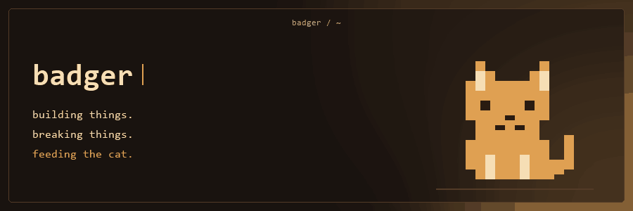
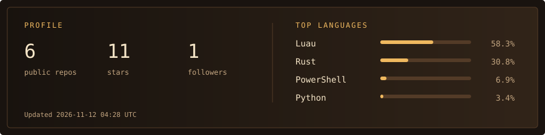
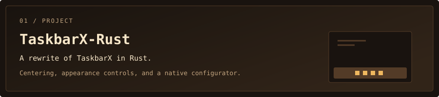
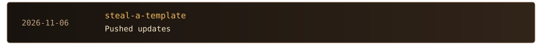

<a href="https://github.com/imafreakandyalldontknowit67">
<picture>
  <source media="(prefers-color-scheme: dark)" srcset="assets/terminal-dark.gif">
  <source media="(prefers-color-scheme: light)" srcset="assets/terminal-light.gif">
  
</picture>
</a>

<!-- stats:start -->
<picture>
  <source media="(prefers-color-scheme: dark)" srcset="assets/stats-dark.svg">
  <source media="(prefers-color-scheme: light)" srcset="assets/stats-light.svg">
  
</picture>
<!-- stats:end -->

### projects

<a href="https://github.com/imafreakandyalldontknowit67/TaskbarX-Rust">
<picture>
  <source media="(prefers-color-scheme: dark)" srcset="assets/project-taskbarx-dark.svg">
  <source media="(prefers-color-scheme: light)" srcset="assets/project-taskbarx-light.svg">
  
</picture>
</a>

<!-- activity:start -->

### recent activity

<a href="https://github.com/imafreakandyalldontknowit67/steal-a-template">
<picture>
  <source media="(prefers-color-scheme: dark)" srcset="assets/activity-0-dark.svg">
  <source media="(prefers-color-scheme: light)" srcset="assets/activity-0-light.svg">
  
</picture>
</a>

<a href="https://github.com/imafreakandyalldontknowit67/steal-a-template">
<picture>
  <source media="(prefers-color-scheme: dark)" srcset="assets/activity-1-dark.svg">
  <source media="(prefers-color-scheme: light)" srcset="assets/activity-1-light.svg">
  
</picture>
</a>

<a href="https://github.com/imafreakandyalldontknowit67/steal-a-template">
<picture>
  <source media="(prefers-color-scheme: dark)" srcset="assets/activity-2-dark.svg">
  <source media="(prefers-color-scheme: light)" srcset="assets/activity-2-light.svg">
  
</picture>
</a>

<!-- activity:end -->

---

[github / badger](https://github.com/imafreakandyalldontknowit67)
